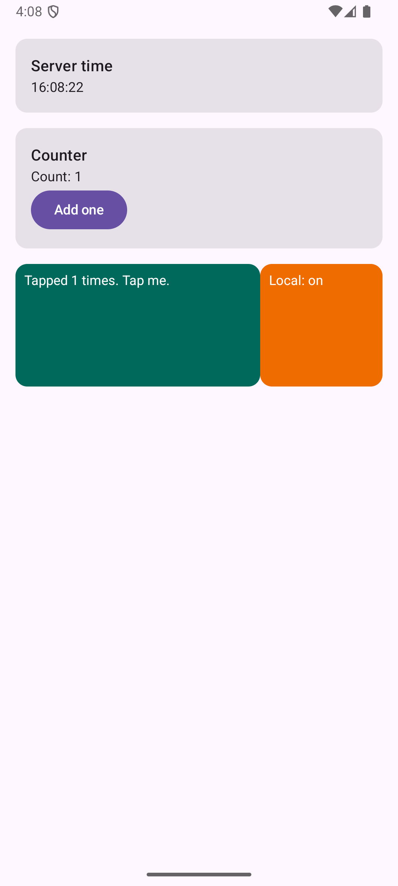

# ssr-compose

A proof of concept for server-side rendering with Jetpack Compose, where composables are shared in both directions between a server and an app.

The idea came out of a discussion about A2UI and AndroidX Remote Compose. The full discussion is in [docs/session-export.md](docs/session-export.md). The design and the plan for this PoC are in [docs/superpowers](docs/superpowers).

## The idea

A server runs composable logic and sends the result to a thin client. One screen can mix two kinds of output:

- When the client already has a composable, the server sends a reference to it with serializable parameters, and the client renders it natively. This is the A2UI half.
- When the client doesn't have it, the server sends that subtree as a recorded document of layout and draw operations, and the client plays it. This is the Remote Compose half.

## What the PoC does

One Android screen comes from one server response:

- The grey card is the app's own Material 3 composable. The server only sent its ID and its parameters. The greeting depends on the server's clock.
- The indigo banner is a Remote Compose document written on the server. The app has no code for it and plays it with the AndroidX player.

## Modules

- `protocol` holds what both sides share: the node tree, the `@Rpc` service interface, and the contract of each shared component (ID and parameters).
- `server` is a plain JVM Ktor app. It runs composables through the Compose runtime with its own `Applier` and returns the tree. Start reading at `HomeScreen.kt`.
- `app` is the Android app. It has a registry from component ID to composable, a tree renderer and a fragment player.

## Running it

You need JDK 17 or newer, the Android SDK with platform 37, and an emulator.

1. Start the server: `./gradlew :server:run`. It listens on port 8787 and serves two screens, `home` (rendered once) and `counter` (live).
2. Connect a phone or start an emulator, run `adb reverse tcp:8787 tcp:8787`, and install the app: `./gradlew :app:installDebug`.
3. Open "SSR Compose" on the emulator.

The app talks to `127.0.0.1:8787` on the device. Forward that port to your machine with `adb reverse tcp:8787 tcp:8787`. This works for an emulator and for a phone on USB.

Tests: `./gradlew build detekt` runs the JVM tests and detekt. `./gradlew :app:connectedDebugAndroidTest` runs the Compose UI tests on a device.

## Interactions and effects

The app opens the `counter` screen as a live session. It sends a `Flow` of action events and gets back a `Flow` of whole trees. On the server each session has its own composition and its own action registry.

- State lives on the server. `CounterScreen` holds the count in `remember { mutableIntStateOf(0) }`. When it changes, the composition recomposes and the app gets a new tree.
- Lambdas stay on the server. `rememberAction { count++ }` gives a lambda an ID. The ID travels in the counter card's props, and the app sends it back when "Add one" is clicked.
- A click on the server-drawn banner does the same. The banner's tap area carries the ID in a Remote Compose host action, and the player hands it to the app.
- Effects run on the server. A `LaunchedEffect` updates the "Server time" card every second with no click from the app.
- The "Local" toggle in the banner changes a variable inside the document. It works with the server stopped.

## What was proven

- Compose logic runs on a plain JVM server. The Compose runtime with a custom `Applier` builds the tree, and `if` and loops in a composable work as expected. No Android and no Compose UI.
- A Remote Compose document can be written without Android. AndroidX ships a Kotlin DSL for it in `remote-creation-core` (`createRcBuffer`), and the server's classpath has no Android artifact.
- A document written on the JVM plays on Android with `RemoteDocumentPlayer` from `remote-player-compose`.
- kotlinx.rpc (kRPC) over Ktor works from an Android app, including a two-way stream, so the service contract is one shared interface.
- A composition can stay alive on the server per client, with `remember` state, `LaunchedEffect` and lambdas, and drive the app's screen.
- Clicks reach server lambdas from the app's own composables and from server-drawn fragments.
- A fragment can carry interactions that need no round trip.

## Limits to know about

- AndroidX Remote Compose is a stand-in here. It proves the played half, and the project does not have to rely on it. Its imports are kept inside `RemoteFragment.kt`, the fragment composables under `server/.../screen`, and `FragmentPlayer.kt`, so our own format and player can replace it.
- Server-only composables are written with the Remote Compose DSL, not with normal Compose UI code. Capturing ordinary composables needs Android.
- The Remote Compose DSL and parts of the player are marked `@RestrictTo` and the library is alpha (`1.0.0-alpha23`), so names can change.
- In that DSL, a click that sets a variable to an expression of itself (`(state + 1) % 2`) only worked once on the device. The toggle sets constants instead. The cause was not found.
- When the server re-sends a fragment because its inputs changed, the fragment's local state (the toggle) starts over.
- The whole tree is sent on every change. There are no diffs.
- Every interaction that is not inside a fragment takes a round trip, and the screen needs the server to be reachable.
- The server keeps one composition per connected app in memory. Each session also registers its own global snapshot observer, which needs to become one shared observer before many sessions run at once.
- A dead server is only noticed through a 2 second WebSocket ping on the app side. Without it the stream hangs.
- The server-side composable that emits a reference is written by hand. It is not generated from the app's composable.
- Fragment sizes are raw pixels. There is no density scaling.
- kRPC caps the Kotlin version at 2.4.20 for now.
- The client is Android only.

## Not answered yet

- Our own document format and player for the played half.
- Hydration: handing a screen over to the app when all of its composables are shared.
- How to handle a client that is missing a referenced component.
- Events that carry data (text input, list items), not just a click.
- How Cash App's Redwood solved the same problem. Its maintainers say it was not stopped for technical reasons.

## References

- [A2UI](https://a2ui.org/) and its [v0.9.1 specification](https://a2ui.org/specification/v0.9.1-a2ui/)
- [AndroidX A2UI renderer](https://developer.android.com/develop/ui/compose/agentic)
- [Remote Compose architecture](https://github.com/androidx/androidx/blob/androidx-main/compose/remote/remote-core/doc/REMOTE_COMPOSE_ARCHITECTURE.md)
- [Remote Compose releases](https://developer.android.com/jetpack/androidx/releases/compose-remote)
- [kotlinx.rpc](https://github.com/Kotlin/kotlinx-rpc)
- [Redwood](https://github.com/cashapp/redwood)
