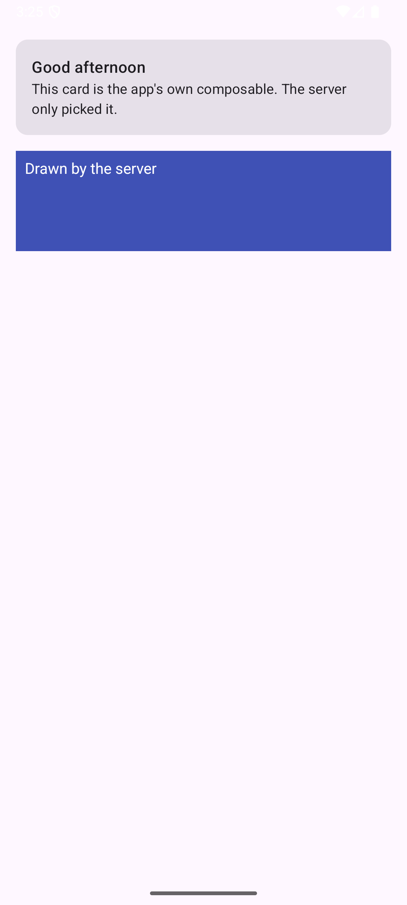

# ssr-compose

A proof of concept for server-side rendering with Jetpack Compose, where composables are shared in both directions between a server and an app.

The idea came out of a discussion about A2UI and AndroidX Remote Compose. The full discussion is in [docs/session-export.md](docs/session-export.md). The design and the plan for this PoC are in [docs/superpowers](docs/superpowers).

## The idea

A server runs composable logic and sends the result to a thin client. One screen can mix two kinds of output:

- When the client already has a composable, the server sends a reference to it with serializable parameters, and the client renders it natively. This is the A2UI half.
- When the client doesn't have it, the server sends that subtree as a recorded document of layout and draw operations, and the client plays it. This is the Remote Compose half.

## What the PoC does

One Android screen comes from one server response:

- The grey card is the app's own Material 3 composable. The server only sent its ID and its parameters. The greeting depends on the server's clock.
- The indigo banner is a Remote Compose document written on the server. The app has no code for it and plays it with the AndroidX player.

## Modules

- `protocol` holds what both sides share: the node tree, the `@Rpc` service interface, and the contract of each shared component (ID and parameters).
- `server` is a plain JVM Ktor app. It runs composables through the Compose runtime with its own `Applier` and returns the tree. Start reading at `HomeScreen.kt`.
- `app` is the Android app. It has a registry from component ID to composable, a tree renderer and a fragment player.

## Running it

You need JDK 17 or newer, the Android SDK with platform 37, and an emulator.

1. Start the server: `./gradlew :server:run`. It listens on port 8787.
2. Start an emulator and install the app: `./gradlew :app:installDebug`.
3. Open "SSR Compose" on the emulator.

The app talks to `10.0.2.2`, which is the host machine as seen from an emulator. A physical phone needs a different host in `MainActivity.kt`.

Tests: `./gradlew build detekt` runs the JVM tests and detekt. `./gradlew :app:connectedDebugAndroidTest` runs the Compose UI tests on a device.

## What was proven

- Compose logic runs on a plain JVM server. The Compose runtime with a custom `Applier` builds the tree, and `if` and loops in a composable work as expected. No Android, no Compose UI, no frame clock.
- A Remote Compose document can be written without Android. AndroidX ships a Kotlin DSL for it in `remote-creation-core` (`createRcBuffer`), and the server's classpath has no Android artifact.
- A document written on the JVM plays on Android with `RemoteDocumentPlayer` from `remote-player-compose`.
- kotlinx.rpc (kRPC) over Ktor works from an Android app, so the service contract is one shared interface.

## Limits to know about

- Server-only composables are written with the Remote Compose DSL, not with normal Compose UI code. Capturing ordinary composables needs Android.
- The Remote Compose DSL and parts of the player are marked `@RestrictTo` and the library is alpha (`1.0.0-alpha23`), so names can change.
- The server-side composable that emits a reference is written by hand. It is not generated from the app's composable.
- The server renders once per request. There are no live updates and no events going back to the server yet. Reference and fragment nodes are not updated on recomposition.
- Fragment sizes are raw pixels. There is no density scaling.
- kRPC caps the Kotlin version at 2.4.20 for now.
- The client is Android only.

## Not answered yet

- Whether AndroidX's capture API (`captureRemoteDocument`) can be used for live updates from a server.
- How events and lambdas should travel back to the server.
- How to handle a client that is missing a referenced component.
- How Cash App's Redwood solved the same problem. Its maintainers say it was not stopped for technical reasons.

## References

- [A2UI](https://a2ui.org/) and its [v0.9.1 specification](https://a2ui.org/specification/v0.9.1-a2ui/)
- [AndroidX A2UI renderer](https://developer.android.com/develop/ui/compose/agentic)
- [Remote Compose architecture](https://github.com/androidx/androidx/blob/androidx-main/compose/remote/remote-core/doc/REMOTE_COMPOSE_ARCHITECTURE.md)
- [Remote Compose releases](https://developer.android.com/jetpack/androidx/releases/compose-remote)
- [kotlinx.rpc](https://github.com/Kotlin/kotlinx-rpc)
- [Redwood](https://github.com/cashapp/redwood)
